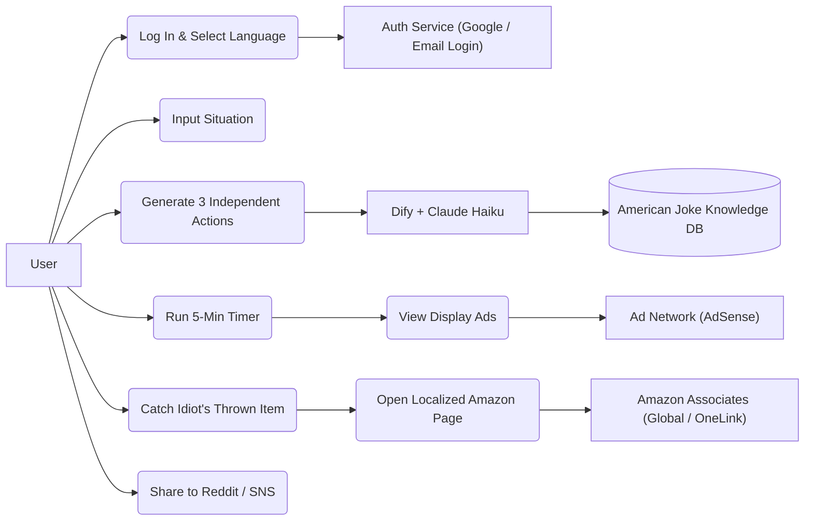
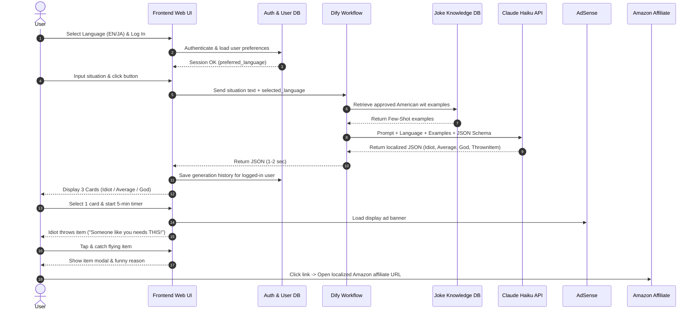
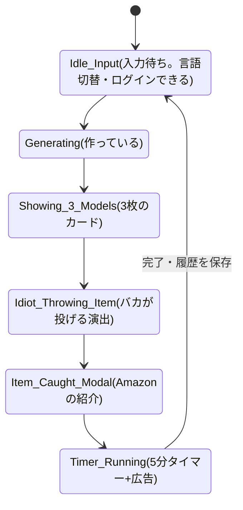
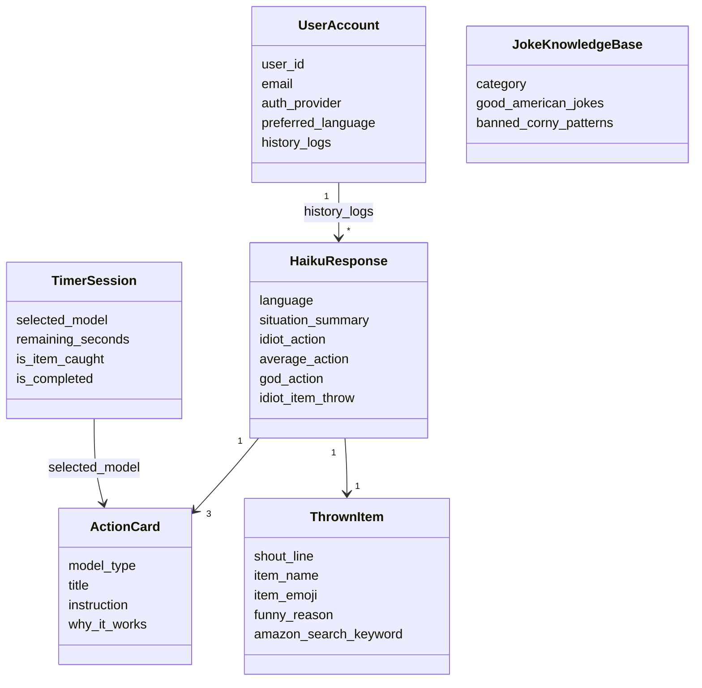

# Next5Mins AI(5分後の行動決定AI) 企画と設計書

- 作った日: 2026-11-04
- もと: 社長がくれた仕様書 `next_5_mins_ai_spec.txt`(全文の中身を、この文書に整理して写した)
- 立場: **社長の案の清書です。事業として始めるかどうかは、まだ決まっていません**(未決事項147)。
- 最後の「秘書室長のメモ」は、秘書室長が読んで気づいたことで、社長の言葉ではありません。

---

## 0. ひとことで

先延ばしで動けない人が「いまの状況」を書くと、3人のAIキャラが、それぞれ別々に「次の5分でやること」を出すWebサービス。

| キャラ | レベル | 何を言うか |
|---|---|---|
| 🤪 バカ(Idiot) | Lv.1 | それっぽいけど、本当に関係ないこと |
| 😐 平凡(Average) | Lv.50 | 普通のこと(本当にいまから5分でできる一歩) |
| ⚡ 神(God) | Lv.999 | できないけど、できたらすごいこと |

- 英語版(サービス名の副題): *What should you do in the next 5 minutes? Ask an Idiot, an Average Joe, or a God.*
- 3人は掛け合いをしない。それぞれ独立して答える。
- 使うのは無料。お金は「Amazonアフィリエイト(紹介料)」と「画面の広告」の2つで得る。

---

## 1. 基本の情報

| 項目 | 内容 |
|---|---|
| サービス名(仮) | Next5Mins AI |
| お客さん | 英語圏を中心に、世界の個人(言語は切り替えられる) |
| 解決する悩み | やることは分かっているのに、何から手をつけるか決められず、スマホを見てしまう(Task Paralysis=やることが多すぎて固まる/先延ばし癖) |
| AI | Anthropic の Claude API。3キャラとも Claude Haiku(安くて速い型)。**Claude Haiku 5.5 にする(社長の答え 2026-11-04。決定事項 2026-11-04 / 8)** |
| AIの流れ・ジョーク集 | Dify(AIの処理の流れを、画面で組める道具)。ワークフロー+ナレッジベース(参考資料の置き場) |
| 画面と登録 | ノーコード(プログラムを書かずに作れる道具)の Lovable / Bolt.new / Bubble のどれか + Supabase Auth(ログインの仕組み) |
| 集める場所 | Reddit(r/Productivity、r/ADHD、r/InternetIsBeautiful など)とSNS |
| 1回のAI費用(仕様書の見込み) | 1回の入力で Haiku を1回だけ呼び、3キャラ+投げる品物をまとめて作る。仕様書では「1回あたり約0.03〜0.05円以下」(→ 秘書室長のメモ M-3 で確認) |

### ログインと言語

- **ログイン(F-09):** Googleアカウントかメールで入れる。ログインした人は、過去の結果・選んだキャラの記録・言語の設定が残る。
- **言語(F-10):** ヘッダーの「🌐 English / 日本語」で切り替え。切り替えると、次の3つが一緒に変わる。
  1. 画面の見出し・ボタン・プリセット(ワンタップの例文)の言葉
  2. AIが答える言語(`{{selected_language}}`)とジョークの調子
  3. バカが投げる品物の行き先(英語→ amazon.com、日本語→ amazon.co.jp)

---

## 2. 3キャラと「投げる品物」の決まり

### 2-1. バカ(Idiot Mode / Lv.1)

- 決まり: それっぽいけど、本当に関係ないことを言う。
- 調子: いかにもアドバイスのような真面目な口調で、悩みと全く関係ないことをさせる。ときどき、ずれた比喩や、シュールなアメリカンジョークをさらっと混ぜる(40語以内)。
- 例(悩み: 確定申告をやらないといけないのに、天井を見つめている):
  「キッチンのスパイスをアルファベット順に並べ替えろ。パプリカに自分の序列を教え込むんだ。財務の透明性はいつだってクミンから始まる。税務署(IRS)はオレガノが整頓されている人間には敬意を払う。」

### 2-2. 平凡(Average Mode / Lv.50)

- 決まり: 普通のことを言う。
- 調子: ふつうの常識で、5分で確実に前に進める小さな一歩を出す。基本はまじめで役に立つ。たまに、乾いたウィット(Dry Wit=淡々とした皮肉)を軽く添える(40語以内)。
- 例: 「まだ計算はしなくていい。次の5分間は、机の上に確定申告用のフォルダを1つ出して、源泉徴収票(W-2)を1枚見つけることだけに使おう。書類を探すのが一番ハードルが高いから、そこだけ越えれば半分終わったも同然。」

### 2-3. 神(God Mode / Lv.999)

- 決まり: できないけど、できたらすごいことを言う。
- 調子: 人間には5分では無理だが、本当にできたら伝説になる行動を出す。スケールの大きさを生かしたブラックユーモアや皮肉の一言を、ときどき挟む(40語以内)。
- 例: 「2分で憲法改正案を起草し、残り3分で38州に批准させて夕食前に税金そのものを違法にしろ。確定申告など凡人の所業だ。連邦法を変えれば会計ソフト代の40ドルが浮くぞ。」

### 2-4. バカの投げる品物(Idiot's Thrown Item)

- バカが「そんなお前にはこれが必要だ!(Someone like you clearly needs THIS!)」と言いながら、画面に品物を投げてくる。
- 飛んでくる品物をタップ(キャッチ)すると、気の利いた一言と一緒に、Amazonの検索結果のページ(アフィリエイトの印つき)が開く。
- 行き先のURL(検索結果ページなので、商品ページのリンク切れが起きない):

| 言語 | URL |
|---|---|
| 英語(EN) | `https://www.amazon.com/s?k={amazon_search_keyword}&tag={USのアソシエイトID}` |
| 日本語(JA) | `https://www.amazon.co.jp/s?k={amazon_search_keyword}&tag={日本のアソシエイトID}` |

---

## 3. 「寒いAIギャグ」を出さない工夫

1. **毎回ボケない。** 基本は各キャラの決まりどおりに行動を出す。本当にキレのある一言が自然に成り立つときだけ、ワンライナー(一言ジョーク)を入れる。
2. **禁止すること(指示文で禁止する):**
   - ありきたりのダジャレ(Puns)・オヤジギャグ(Dad jokes)
   - 「!」の多用・はしゃぎすぎのノリ
   - ジョークのあとに自分で解説すること
3. **お手本集(Few-Shot=指示文に入れるお手本 / RAG=参考資料を探して渡す仕組み):** Dify のナレッジベースと指示文に、アメリカのスタンダップコメディや、Reddit で高く評価された「乾いた皮肉」「自虐」「鋭い観察の一言」の例を入れて、Haiku に調子と間を合わせさせる。(→ 秘書室長のメモ M-6 で、著作権と規約の確認が要る)

---

## 4. AIが返す形(JSON)

1回の呼び出しで、次の形をまとめて返させる。

```json
{
  "language": "en",
  "situation_summary": "Need to do taxes, staring at the ceiling instead",
  "actions": {
    "idiot": {
      "title": "Alphabetize your spice rack",
      "instruction": "Go to the kitchen and arrange your spices alphabetically. Make sure paprika knows its place. Financial clarity always starts with cumin.",
      "why_it_works": "The IRS respects a man with organized oregano."
    },
    "average": {
      "title": "Just find one tax form",
      "instruction": "Don't calculate anything yet. Spend the next 5 minutes just finding your W-2 or opening your tax folder on your desk.",
      "why_it_works": "Gathering documents is the hardest mental hurdle. Once it's open, you're halfway there."
    },
    "god": {
      "title": "Lobby Congress to abolish the IRS",
      "instruction": "Draft a constitutional amendment in 2 minutes, get 38 states to ratify it in 3, and make taxes illegal before dinner.",
      "why_it_works": "Filing taxes is for mortals. Changing federal law saves you at least $40 on TurboTax."
    }
  },
  "idiot_item_throw": {
    "shout_line": "Someone like you clearly needs THIS!",
    "item_name": "Inflatable T-Rex Costume",
    "item_emoji": "🦖",
    "funny_reason": "Extinct reptiles are legally exempt from capital gains tax.",
    "amazon_search_keyword": "inflatable t-rex costume adult"
  }
}
```

| 欄 | 意味 |
|---|---|
| `language` | 答えた言語(en / ja など) |
| `situation_summary` | 悩みの短いまとめ |
| `actions.idiot / average / god` | 3キャラの答え。`title`=見出し、`instruction`=やること、`why_it_works`=なぜ効くか(の一言) |
| `idiot_item_throw` | バカが投げる品物。`shout_line`=叫ぶ言葉、`item_name`=品名、`item_emoji`=絵文字、`funny_reason`=おかしな理由、`amazon_search_keyword`=Amazonで探す言葉 |

---

## 5. Haiku への指示文(仕様書の原文。英語のまま)

```text
You are the engine behind "Next5Mins AI", an app that gives procrastinating users a 5-minute action from 3 independent models: Idiot, Average, and God.

Target Output Language: {{selected_language}} (Output all fields, including amazon_search_keyword, in {{selected_language}}).

Core Rules for the 3 Models (Keep them independent - do NOT make them talk to each other):
1. "idiot": Tell them to do something that SOUNDS like plausible advice at first glance, but is actually COMPLETELY UNRELATED to their problem.
2. "average": Give normal, grounded, genuinely helpful 5-minute advice that anyone can do right now.
3. "god": Tell them to do something impossible for a human to do in 5 minutes, but legendary if they actually pulled it off.
4. "idiot_item_throw": The Idiot throws a searchable Amazon item at the user saying "Someone like you clearly needs THIS!"

Humor & American Joke Guidelines (CRITICAL):
- DO NOT force a joke every single time. Only drop a joke or dry one-liner when it hits naturally. Sometimes playing it completely straight is funnier.
- NEVER use corny AI humor, dad jokes, puns, or over-the-top exclamation marks.
- When you do use humor, use sharp American dry wit, deadpan delivery, cynical observational humor, or understated irony (similar to high-upvoted Reddit comments or stand-up comedy).
- Study and match the tone of the <approved_humor_examples> provided in the knowledge base.

Respond ONLY with valid JSON matching the schema. Keep each instruction under 35 words.
```

日本語の大意: 3キャラは独立させ、掛け合いさせない。全部の欄(Amazonの検索語も)を選んだ言語で出す。ジョークは毎回言わず、決まるときだけ。ダジャレ・オヤジギャグ・「!」の多用は禁止。ユーモアは乾いた皮肉・真顔のボケ・控えめな皮肉で、お手本集の調子に合わせる。答えはJSONだけ。やること(instruction)は35語以内。

---

## 6. 機能の一覧(最初の版=MVP)

| 番号 | 機能 |
|---|---|
| F-01 | 状況の入力と、プリセット(ワンタップの例文)の選択 |
| F-02 | Haiku で3キャラ+投げる品物をまとめて作る |
| F-03 | アメリカンジョークのお手本集(RAG / Few-Shot) |
| F-04 | 行動を1つ選んで、5分のカウントダウン |
| F-05 | バカの「これが必要だ!」投げる品物とキャッチの演出(お金① アフィリエイト) |
| F-06 | 画面の広告の枠(お金② ディスプレイ広告) |
| F-07 | Reddit / SNS への共有 |
| F-08 | 連打の制限(IPごと・ユーザーごと。Rate Limit) |
| F-09 | ログイン(Google / メール)。履歴と設定を保存 |
| F-10 | 表示と答えの言語の切り替え(画面・AIの答え・Amazonの国を一緒に切り替え) |

---

## 7. 設計の図(UML)

### 7-1. 使う場面(ユースケース)

- ユーザー: ログインする → 言語を選ぶ → 状況を入れる → 3キャラを見る → 5分タイマーと広告 → 投げられた品物をキャッチして、その国のAmazonへ → Reddit/SNSに共有
- 登録の仕組み(Supabase Auth / Bubble Auth): ログインとユーザー設定を持つ
- Dify + Haiku: 選んだ言語とジョークのお手本集を見て、JSONをまとめて作る



### 7-2. 処理の順番(シーケンス)

1. ユーザーがログインし、言語(例: EN か JA)を選ぶ
2. 状況を入れてボタンを押す → 画面が「状況の文+選んだ言語」を Dify に送る
3. Dify がジョーク集からお手本を取り、言語の指定と一緒に Haiku に送る
4. Haiku が1〜2秒で、選んだ言語のJSON(3キャラ+投げる品物)を返す
5. 3枚のカードを出し、ログインしている人なら履歴に保存
6. 1枚を選ぶと、5分タイマーと下の広告が出る
7. 同時に、バカが「これが必要だ!」と品物を投げる
8. タップしてキャッチ → 選んだ言語の国の Amazon アフィリエイトURLへ



### 7-3. 画面の状態の移り変わり

仕様書の順番のまま図にした(順番の食い違いは、秘書室長のメモ M-2)。



### 7-4. データの形(クラス)



(つなぎの線は、仕様書の欄の名前から秘書室長が読んで足したもの。仕様書には線の指定はない。)

---

## 8. 画面の設計(パーツ1: 全体の枠と、状況の入力)

### 8-1. 色(白が基本の、明るい画面)

白を基本にして、3キャラの色と、あとで飛んでくる「投げる品物」がいちばん目立つ色の組み合わせ。

| 用途 | 色 | 説明 |
|---|---|---|
| ページ全体の背景 | `#F8FAFC` | ごく薄いグレーの白(白いカードを浮かせる) |
| 枠・入力欄・カードの背景 | `#FFFFFF` | 純白 |
| 枠線・区切り線 | `#E2E8F0` | 薄いグレー |
| 本文の文字 | `#0F172A` | 黒に近い濃紺 |
| 補足・入力前の薄い文字 | `#64748B` | 中くらいのグレー |

| キャラ | 文字・枠の色 | バッジの背景 |
|---|---|---|
| 🤪 バカ | `#F59E0B`(アンバーゴールド) | `#FEF3C7`(薄い黄) |
| 😐 平凡 | `#0EA5E9`(スカイブルー) | `#E0F2FE`(薄い青) |
| ⚡ 神 | `#A855F7`(パープル) | `#F3E8FF`(薄い紫) |

- 決定ボタン: `#0EA5E9`(スカイブルー)→ `#A855F7`(パープル)のグラデーション。

### 8-2. ページ全体の作り

- 白が基本の1ページ。ヘッダーに言語選択とログインを常に出す。
- いちばん広くて1024px(パソコンでは中央寄せ。スマホでは左右16pxの余白で1列)。
- 上から5つのパーツ:

| パーツ | 中身 | 出るとき |
|---|---|---|
| 1 | ヘッダー(ロゴ・3キャラのバッジ・言語・ログイン)と状況の入力 | 最初から |
| 2 | バカ・平凡・神の3枚のカード | 作ったあと |
| 3 | 5分タイマーと広告の枠 | カードを選んだあと |
| 4 | バカの「これが必要だ!」投げる品物の演出(画面の上に重ねる) | タイマー中など |
| 5 | Reddit / SNS の共有と、フッター | 最後 |

### 8-3. パーツ1の配置(文字の下書き)

```text
+--------------------------------------------------------------------+
| [5m] Next5Mins AI   (🤪 Idiot)(😐 Average)(⚡ God)  [🌐 EN/日本語 ▾] [Log In] |
+--------------------------------------------------------------------+
|                         Part 1: Situation Input                    |
|                                                                    |
|          What are you procrastinating on right now?                |
|                                                                    |
|  +--------------------------------------------------------------+  |
|  | E.g., I'm staring at an empty document for my history paper, |  |
|  | scrolling social media instead...                            |  |
|  |                                                              |  |
|  | [🎲 Random Situation]  [✕ Clear]                  0 / 240    |  |
|  +--------------------------------------------------------------+  |
|                                                                    |
|  (Studying) (Writing) (Exercise) (Work Task) (Chores) (Emails)     |
|                                                                    |
|                                    +----------------------------+  |
|                                    | Decide My Next 5 Mins  >>  |  |
|                                    +----------------------------+  |
+--------------------------------------------------------------------+
```

### 8-4. パーツ1の部品の動き(ノーコードで作るときの設定)

**(1) ヘッダー**(背景 `#FFFFFF`・下線 `#E2E8F0`)
- 左: ロゴ+「Next5Mins AI」
- 真ん中: 3キャラの色つきバッジ(バカ=黄、平凡=青、神=紫)
- 右①: 言語の選択(`🌐 EN / 日本語 ▾`。F-10)
  - 選べるもの: English (EN) / 日本語 (JA) / Español (ES) など
  - 切り替えた瞬間に、画面の言葉・AIの答えの言語(`{{selected_language}}`)・Amazonの行き先(EN→amazon.com、JA→amazon.co.jp)が変わる
- 右②: ログイン(`Log In`。F-09)
  - ログイン前: 「Log In」ボタン。押すと、Google かメールでログインする小窓が開く
  - ログイン後: ユーザーのアイコン+「My History(これまでの5分の行動の履歴)」のメニューに変わる。選んだ言語はアカウントに自動で保存

**(2) 状況の入力欄**(背景 `#FFFFFF`・枠線 `#CBD5E1`)
- 入力前の薄い例文(言語で変わる):
  - EN: 「E.g., I'm staring at an empty document...」
  - JA: 「例:明日テストなのにベッドでSNSを無限に見ている…」
- 入力中: 枠線がスカイブルー(`#0EA5E9`)に光り、軽い影がつく
- いちばん長くて240文字

**(3) プリセット(ワンタップの例文。F-01)**
- 背景 `#F1F5F9`・文字 `#334155` の、角の丸いボタン
- 言語に合わせて、ボタンの言葉と入る文が変わる(例: Studying / 勉強・試験、Work Task / 仕事のタスク、Chores / 部屋の片付け など)

**(4) 決定ボタン**
- 文字: EN「Decide My Next 5 Mins >>」/ JA「5分後の行動を決める >>」
- 押すと: 入力した文と言語の記号(`language: "en"` か `"ja"` など)をまとめて Dify(Haiku)に送り、パーツ2を開く

(仕様書は、パーツ1まで。パーツ2〜5の細かい設計は、まだない。)

---

## 9. 秘書室長のメモ(読んで気づいた点。社長の言葉ではない)

決定ではありません。作り始める前に、社長に決めてほしい点と、確かめが要る点です。

### 仕様の中の食い違い

- **M-1 語数:** キャラの説明は「40語以内」、指示文は「35語以内(instruction)」。どちらかにそろえる。
- **M-2 順番:** 状態の図は「カード → 投げる → キャッチ → タイマー」、処理の順番は「カードを選ぶ → タイマーと広告 → 同時に投げる」。投げるのはタイマーの前か、タイマー中か、を決める。
- **M-3 1回の費用:** 「1回あたり約0.03〜0.05円以下」は、ジョークのお手本を指示文にたくさん入れると、読ませる量が増えて上がる。点検室が Anthropic の料金ページで計算した値(2026-11-04 時点。1ドル=150円の仮置き):
  - Claude Haiku 5.5(入力 $0.10・出力 $0.50/100万トークン): 1回 約0.06〜0.10円(読ませる量 1,500〜4,000トークン、答え 500トークン)。仕様書の見込みの約1.2〜3倍。
  - 1つ前の Haiku 4.5(入力 $1・出力 $5): 1回 約0.6〜1円。仕様書の見込みの約12〜32倍。
  - どの Haiku を使うかで10倍ちがう。Dify の費用は入っていない。モデル名と料金は、作る直前にもう一度確かめる。
  - → 社長が「Haiku 5.5」と答えた(2026-11-04。決定事項 2026-11-04 / 8)。
- **M-4 道具の数:** 画面の道具が3つ(Lovable / Bolt.new / Bubble)、登録の仕組みが2つ(Supabase Auth / Bubble Auth)書いてある。1つに決める。Dify も、自分で置くか、有料の Dify Cloud にするかで費用が変わる。

### 法律・規約で確かめること(社長の方針「法律に触れることはしない」に関わる)

- **M-5 アフィリエイトと広告の表示:** 紹介料をもらうリンクは、広告だと分かるように表示する決まりがある(日本はステマ規制=景品表示法。アメリカは FTC の決まり。Amazon アソシエイトにも、決まった一文を載せる決まりがある)。アメリカと日本の Amazon アソシエイトは別々の登録で、それぞれ審査がある。**(未確認: 公式のページを開けなかった。表示の一文の正確な言葉は各国の規約の原文で確かめ、当てはめは専門家=行政書士・弁護士に確かめる。)**
- **M-6 ジョークのお手本の集め方:** Reddit の書き込みや、コメディアンのネタをそのまま写してナレッジに入れると、著作権と Reddit の規約(書き込みの商用利用の制限)にふれるおそれがある(規約の原文は未確認。作る前に原文で確かめる)。お手本は、自分たちで書いた文にするか、調子の説明だけにする案がある。なお「学習させる」は、AIを作り直す(訓練)のではなく、毎回お手本を見せるだけ。
- **M-7 Reddit での宣伝:** Reddit 全体のスパムの決まりと、板(サブレディット)ごとの決まりで、自分のサービスの宣伝は制限されうる。禁止・制限している板が多い(板ごとにちがう)。板ごとの決まりを読んでから、社長が投稿する。(公式のページは未確認。)
- **M-8 入力された悩みと履歴:** 悩みの文は Dify と Anthropic に送られ、ログインした人の分は保存される。r/ADHD など、心や体のことが書かれやすい場所から人が来る。プライバシーポリシー(個人情報の扱いの説明)が要る。海外の人(EUなど)がいる場合、GDPR(EUの個人情報の決まり)など、その国の決まりがかかりうる。健康に関する話は、特に慎重な扱いが要りうる(専門家に確かめる)。会社の方針「お客さんの個人情報をAIに入れる仕事はしない」(未決事項11)との関係も、社長に確かめる。

### 安全と作り方で気をつけること

- **M-9 ふざけてはいけない入力:** 「死にたい」など、つらい内容が書かれたときは、ジョークを出さず、相談先を出す仕組みが要る。投げる品物も、危ないもの・大人向けのものを出さない絞り込みが要る。
- **M-10 鍵の置き場所:** AIの鍵(APIキー)は、画面側(ノーコードの道具の画面)に置かず、Dify などサーバー側だけに置く。連打の制限(F-08)も、サーバー側で行う。

### 会社の記録とのつながり

- アフィリエイトをする(決定事項 2026-10-28 / 1)、海外向けサービスの種(未決事項146)と方向が近い。
- この案を事業として進めるかは、未決事項147(社長が決める)。
- 作るときは、パーツを1つずつ作り、`成果物/企画部/2026-11-04_Next5MinsAI_パーツ別_もとと実物の比べ表.md` で、もとと実物を比べる(決定事項 2026-11-04 / 9)。

## 10. 点検室の確かめの結果

- 2026-11-04、事実確認員が9章を確かめた。所見は `成果物/点検室/2026-11-04_Next5MinsAI_事実確認.md`。
- M-3(費用)は、料金ページで確かめて数字を直した。
- M-5〜M-8(法律・規約)は、このクラウドの通信の許可の外で公式のページを開けず、**未確認**。書き方は「おそれ」「かかりうる」にとどめた。作る前に、原文と専門家で確かめる。
- 1〜8章は社長の仕様の写しなので、点検していない。
